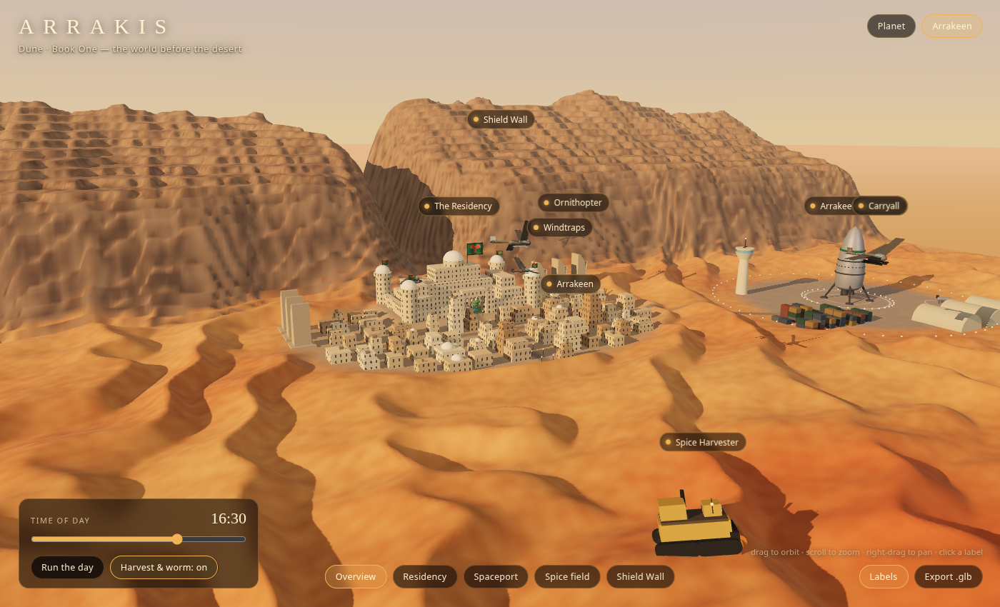

# Arrakis: a 3D model of Dune, Book One

An interactive three.js model of Arrakis as it appears in the first part of *Dune*, from the Atreides arrival to just before Paul and Jessica go out into the desert. Everything is generated procedurally; there are no external assets.

**Live: https://moshemiz06.github.io/sonnet-dune-model/**



## Run it

```bash
npm install
npm run dev        # http://127.0.0.1:5173
npm run build      # static site in dist/ (serve it with any static server)
```

Add `?q=low` to the URL for a lower pixel ratio on weak GPUs. The app also drops quality by itself if frames run slow.

## Two views

**Planet.** A procedural globe of Arrakis: rippled ergs, polar frost, the Imperial Basin, and the Shield Wall as a rock arc curling around it. Two tidally locked moons orbit it; the second carries the desert-mouse pattern the Fremen see. A Guild Heighliner circles in orbit. Click a marker for notes, then **Descend to Arrakeen**.

**Arrakeen.** A ~2 km diorama of the setting of Book One:

| Thing | What's modelled |
| --- | --- |
| Shield Wall | Layered cliff massif with erosion grooves and a canyon (the "Old Gap") behind the city |
| Arrakeen | ~500 stepped sandstone blocks with slit windows that light up at night, domes, street lamps, windtraps |
| The Residency | Walled compound with corner towers, stepped great hall and dome, garden court with pool, rooftop pad and flapping green-and-black Atreides banners with the red hawk |
| Spaceport | Landed Atreides frigate, control tower, hangars, lighters, cargo stacks, pad lights |
| Spice field | Spice-stained dunes, a tracked harvester, a carryall, and a sandworm with a toothed mouth |
| Air traffic | Four ornithopters on patrol routes, plus one parked on the Residency roof |

The harvest scene loops every 72 s: the harvester crawls, a sand ridge races toward it, the carryall drops in and lifts the machine clear as the worm breaches alongside, then sets it back down.

## Controls

- Drag to orbit, scroll to zoom, right-drag to pan.
- Click any label for notes; the camera flies there.
- **Arrakeen** view: presets along the bottom (keys `1`-`5`), a time-of-day slider (dawn, golden hour, dusk, moonlit night), **Run the day**, and a toggle to pause the harvest/worm loop.
- **Export .glb** saves the current view as a binary glTF (sky, atmosphere and dust are left out).

## Layout

```
src/
  main.js            renderer, view switching, labels, camera flights, GLB export
  planet.js          globe textures, moons, Heighliner, markers
  sky.js             sky dome, stars, time-of-day palette, moon textures
  locations.js       place names and notes
  arrakeen/
    terrain.js       analytic height field (dunes, wall, shelves) + vertex colours
    city.js          instanced buildings, Residency, windtraps, banners
    spaceport.js     frigate, tower, hangars, containers
    craft.js         ornithopter, carryall, harvester
    worm.js          sandworm, sand ridge, dust particles
    index.js         scene assembly, lighting, and the harvest choreography
    materials.js     stone shader with world-space windows
```

## Notes on fidelity

Herbert's maps are schematic, so the latitude/longitude positions on the globe and the exact layout of Arrakeen are interpretive. The text paraphrases what Book One establishes; it doesn't quote it. Scale is stylised: the worm and harvester are sized to read clearly next to the dunes.
